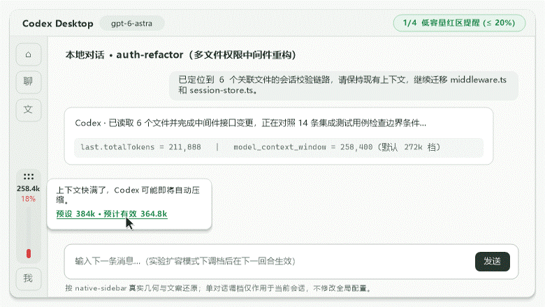
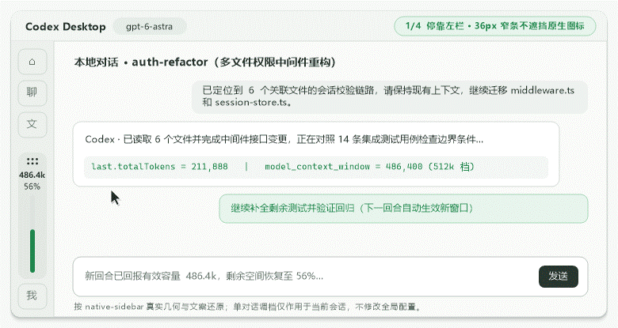
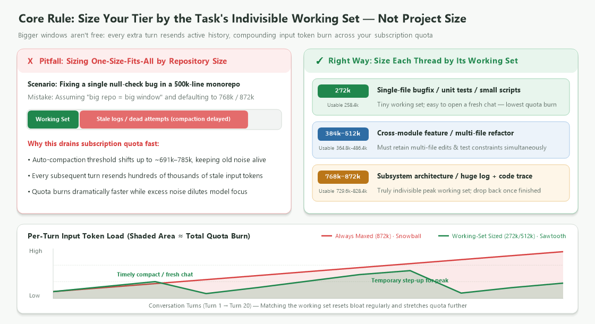
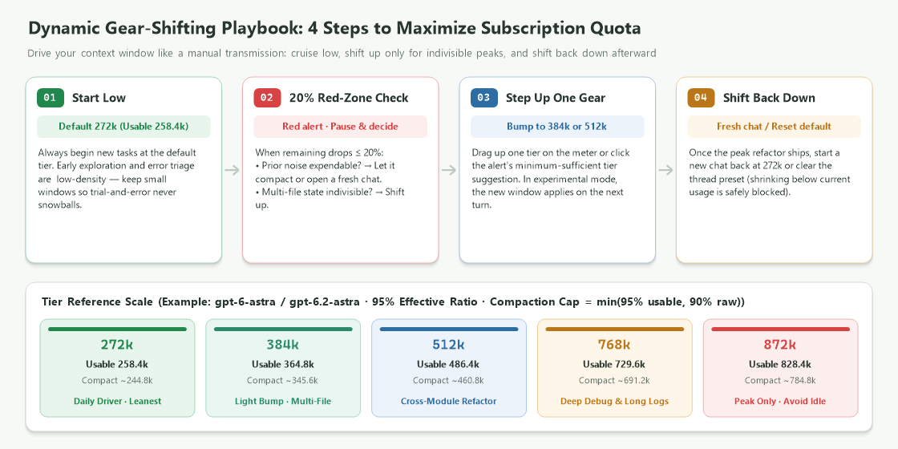

# Codex Context Manager

[简体中文](README.md) | **English**

> **Local context window monitor and per-conversation tier manager for Windows x64 Codex Desktop (`v0.1.0`)**
>
> Spend your subscription allowance on context the task still needs. The sidebar shows how much room the current chat has left, helping you decide when to continue, when to compact, and which chat is worth expanding.
>
> *Existing Context Lens installations can upgrade in place; Start Menu entries, shortcuts, and the sidebar extension ID continue to use **Context Lens**.*

[Download the Windows x64 installer](https://github.com/loyce-cheng/codex-context-manager/releases/download/v0.1.0/Codex-Context-Manager-0.1.0-windows-x64-Setup.exe) · [View the 0.1.0 assets and SHA-256 checksums](https://github.com/loyce-cheng/codex-context-manager/releases/tag/v0.1.0)

---

The downloads are the published `v0.1.0` binaries. For subsequent source fixes on `main`, see the [review decisions](docs/REVIEW-0.1.0.md).

## Table of Contents

- [Why Manage the Context Window](#why-manage-the-context-window)
- [Visual Walkthrough](#visual-walkthrough)
  - [Tier Adjustment and Next-Turn Confirmation](#tier-adjustment-and-next-turn-confirmation)
  - [Docked Rail and Floating Modes](#docked-rail-and-floating-modes)
- [Sizing by Indivisible Working Set](#sizing-by-indivisible-working-set)
  - [What Is an Indivisible Working Set](#what-is-an-indivisible-working-set)
  - [Tier Reference Table](#tier-reference-table)
- [Dynamic Gear-Shifting Playbook](#dynamic-gear-shifting-playbook)
- [Installation and Usage](#installation-and-usage)
- [Capabilities and Compatibility](#capabilities-and-compatibility)
- [Privacy and Security](#privacy-and-security)
- [Troubleshooting](#troubleshooting)
- [Development and Build](#development-and-build)
- [License](#license)

---

## Why Manage the Context Window

The window sets an upper bound on what a request can hold. Moving from `272k` to `512k` does not itself create `240k` input tokens. The difference shows up as history accumulates. A larger window can defer compaction, so old logs may return as input on each subsequent request. A smaller window can compact sooner, sometimes forcing Codex to read a file again. Sizing each chat for its task can reduce both irrelevant input and repeated reads, helping the same subscription allowance cover more useful work. Actual usage also depends on the model, task, reasoning, and tools. [How OpenAI describes Codex subscription usage](https://help.openai.com/en/articles/11369540-using-codex-with-your-chatgpt-plan)

**Long context can add up even when every request hits the cache.** Token-based Codex credit plans charge a lower, nonzero rate for cached input. Sending the same log with 20 requests can count it as cached input 20 times. A single user instruction can generate several model requests. Check your account’s usage page for your remaining included allowance. [OpenAI’s guide to Codex usage and cached-input rates](https://learn.chatgpt.com/docs/pricing?codex-pricing-plans=individual#token-rates)

- **You found the bug and only need a two-line fix.** Suppose the old logs occupy `60k` tokens and the reproduction steps and error summary occupy `5k`. Carrying those logs instead of the summary through the next 20 model requests adds `(60k − 5k) × 20 = 1.1M` input tokens. Even if this material is fully cached in both cases, an illustrative rate of `10 credits` per million cached input tokens puts that difference alone at `11 credits`. This excludes the work of generating the summary. Actual rates depend on the model and billing plan.
- **You are migrating a protocol and still need to check every old field.** If the field table, callers, and failing assertions all matter to the next step, early compaction can lead to repeated reads. Temporarily move just the migration chat to `512k` and keep the release-notes chat at the model default. Once the migration passes, carry a short record of the decisions into the follow-up work.

When the sidebar shows **20%**, about one fifth of the current chat’s context space remains. Check the Codex usage page for your account allowance. Standard monitoring helps you make these decisions. Verified experimental combinations can also change the window for an individual chat.

---

## Visual Walkthrough

### Tier Adjustment and Next-Turn Confirmation

At **20% remaining or less**, the bar turns red and shows a five-second warning. Drag the bar, or use the arrow keys and Enter, to preview effective capacity and remaining space. Releasing saves a preset for this chat and model. In experimental mode, wait for **已提交** (*Submitted*) and send the next message. **已生效** (*Active*) with a measured capacity confirms the backend applied the tier. The 20% alert is a sidebar threshold. Codex controls when compaction occurs.



> *Note: The shipped sidebar UI currently uses Chinese copy (`预设已保存` = Preset saved, `已提交` = Submitted, `已生效 · 486.4k` = Active · 486.4k). The animation faithfully reproduces the actual `native-sidebar` geometry, transitions, and receipt lifecycle.*

### Docked Rail and Floating Modes

By default, the meter docks as a **36px-wide strip** inside Codex's left navigation rail (never covering native buttons, and auto-hiding if vertical space gets too tight). Drag rightward from the 6-dot grip to detach into a **floating horizontal pill**, or right-click to switch to a **floating vertical bar**, re-dock to the left rail, inspect presets, or clear the current thread's override. Layout preferences persist independently per window:



---

## Sizing by Indivisible Working Set



The most common mistake is picking a high tier simply because your repository is large. **Never choose a tier based on "project size"—always choose based on the current task's "Indivisible Working Set".**

### What Is an Indivisible Working Set

It is the **minimum set of files, interface contracts, diffs, logs, and constraints that the model must hold in memory simultaneously** across one coherent chain of reasoning without losing critical state to mid-task compaction.

- **Small task inside a huge repo → Stay on the small tier**: Fixing a null-check bug in a 500k-line monorepo typically involves only 2–3 files and one test output. Start with the current model’s default and open a fresh chat when the fix is complete.
- **Hard task inside a small repo → Step up temporarily**: Even in a 20k-line codebase, migrating a tightly coupled protocol, state machine, and integration suite simultaneously can make mid-flight compaction very costly. Stepping up temporarily to **`384k` or `512k`** avoids losing state and reduces rework.

### Tier Reference Table

The full launcher reads the local model catalog. The standalone ZIP uses a bundled snapshot. This table uses snapshot values for `gpt-6-astra` / `gpt-6.2-astra` (`272k` default, `872k` max, `95%` effective window ratio). Compaction points are experimental tier estimates. The backend controls the actual default compaction policy.

| Configured Tier | Usable Context (`95%`) | Est. Compaction Point | Working Set Profile | Typical Tasks |
| :--- | :--- | :--- | :--- | :--- |
| **`272k` (Default)** | **`258.4k`** | `244.8k` | Small, clean boundary, easy to reset | Single-file bugfix, unit tests, code explanation, standalone scripts |
| **`384k`** | **`364.8k`** | `345.6k` | Light multi-file context | 3–6 related files, API schema alignment, medium PR reviews |
| **`512k`** | **`486.4k`** | `460.8k` | Medium indivisible working set | Cross-module features, multi-file refactors, end-to-end test debugging |
| **`768k`** | **`729.6k`** | `691.2k` | Large indivisible working set | Core subsystem refactors, long stack/trace logs + multi-module tracing |
| **`872k` (Max)** | **`828.4k`** | `784.8k` | Extreme one-off peak (**avoid idling**) | Rare un-splittable architecture sweeps; open a fresh chat once done |

> **Note**: Models with larger defaults expose their own ladder (for example, `gpt-6.2-sol`, `gpt-6.1-sol`, and `gpt-6.1-terra` default to `500k` / `475k` usable with tiers `500k / 512k / 768k / 872k`). Right-click the meter and pick **查看容量预设** (*View capacity preset*) to inspect the catalog default and estimates for the selected preset.

---

## Dynamic Gear-Shifting Playbook



Treat context tiers like a **manual transmission** rather than a set-and-forget global preference:

1. **Start at the Current Model’s Default**
   Never pre-expand a brand-new chat. Discovery, code search, and error reproduction generate high noise—starting small keeps early trial-and-error from snowballing into later turns.
2. **Pause and Branch at the `≤ 20%` Red Zone**
   When the meter turns red at `≤ 20%` and shows the 5-second alert, ask one quick question: *"Does the next step strictly require keeping all earlier details verbatim?"*
   - **Mostly exploration noise or milestone complete** → **Do not expand.** Let Codex compact naturally, or summarize key decisions and start a **fresh chat** using the current model’s default.
   - **Mid-way through an indivisible multi-file edit** → Move to Step 3 and step up cleanly.
3. **Step Up One Gear at a Time (Avoid Jumping Straight to Max)**
   - If available, click the alert bubble’s **one-click suggestion** (automatically picks the smallest tier that restores `> 20%` headroom), or drag the bar up one step to **`384k` or `512k`**.
   - In experimental mode, once **`已提交`** (*Submitted*) appears, send your next message—the new window applies on that turn and confirms with **`已生效 · 486.4k`**. Any turn already streaming finishes safely on its captured window.
4. **Shift Back Down After the Peak & Isolate Concurrent Threads**
   - **Per-thread isolation**: Keep Thread A (heavy refactor) at `512k` while Thread B (quick utility/Q&A) stays at `272k` in the same Codex window—global settings are never mutated.
   - **Drop back afterward**: Start a fresh chat at the selected model’s default after finishing a peak task, or clear the override via the right-click menu after compaction. If current usage reaches the lower tier’s estimated compaction threshold, the slider prompts you to choose a larger tier. After clearing a preset, confirm the measured capacity on a later experimental turn.

---

## Installation and Usage

### Option 1: Windows x64 Installer (Recommended)

1. Install Windows Codex Desktop first, then save your work and fully exit both Codex and Codex Script Loader.
2. Download and run `Codex-Context-Manager-0.1.0-windows-x64-Setup.exe` from the Release page (unsigned Windows binary; verify integrity with `Get-FileHash -Algorithm SHA256` against `SHA256SUMS.txt`).
   - The default option installs **Monitor Only**; when your installed Codex Desktop and Loader match a verified combination, **Monitor + Experimental Expansion** becomes selectable.
   - Bundles the pinned Node.js runtime and portable Loader; existing compatible shared Loader installations are automatically reused while preserving other extensions’ configuration.
3. Launch from the Start Menu **Context Lens** folder:
   - **Codex + Context Lens**: Daily sidebar monitoring (with per-chat preset saving).
   - **Codex + Context Lens（实验扩容）**: Experimental per-conversation window adjustment (installed only when selected; switching from stock Codex waits up to 15 minutes for you to save and exit, then launches automatically).
   - **查看状态** (*Status*): Read-only check of live sidebar telemetry, layout fit, and desktop/Loader compatibility.
   - **恢复 Loader** (*Recover Loader*): Opens Loader's native diagnostics window to exit a lingering background Loader after updates (or safely terminates a verified orphan instance once all Codex windows are closed).

### Option 2: Standalone Sidebar Extension ZIP

If you already manage [Codex Script Loader](https://github.com/JHees/codex-script-loader) yourself and only want monitoring, download `context-lens-sidebar-0.1.0.zip` and import/enable it in Codex Settings → Script Loader (no Node, Python, or admin rights required).

> **Note**: Importing only the sidebar ZIP provides live monitoring and preset saving; actual per-conversation backend expansion requires the verified experimental components from the full installer.

### Upgrading and Uninstalling

- **In-place upgrade**: Exit Codex and Loader, then run the newer installer. Existing Loader configuration, other extensions, chats, and preferences are preserved.
- **Uninstall**: Go to **Windows Settings → Apps → Installed apps → Codex Context Manager**.

---

## Capabilities and Compatibility

| Capability | Standard Monitor Mode | Experimental Expansion Mode |
| :--- | :--- | :--- |
| Live effective capacity & remaining `%` in left rail | Supported (remaining % = `100 × (1 − last.totalTokens / modelContextWindow)`, clamped to 0–100) | Supported |
| Low-capacity alert (`≤ 20%` red, re-arms `> 25%`) | Supported | Supported |
| Docked rail / floating horizontal & vertical / per-window memory | Supported | Supported |
| Drag or keyboard tier preview & `(thread, model)` presets | Supported | Supported |
| Per-conversation backend window change (next turn + measured receipt) | Saves preset only (stock backend untouched) | **Supported (verified combinations only)** |
| Automatic read-only page asset check after Codex updates | Checks Rspack assets at launch | Safely falls back to standard monitor on unverified updates |
| Remote or cloud threads, or no selected local chat | Unsupported (clears readings rather than showing stale values) | Unsupported |

- **Verified experimental combinations**: Windows x64 Codex `26.1117.3838.0` or `26.1117.4957.0` + Codex Script Loader `0.6.2` (paired with experimental backend `0.171.0-alpha.13`).
- **Bundled sidebar profiles**: Includes `26.1120.5083.0` and earlier verified Rspack/ESM builds; newer Codex updates are checked locally before launch via read-only AST inspection and fail closed if identity/usage/layout checks do not match.
- **Alternative read-only modes**: The repository also includes a read-only MCP side panel and standalone local file/HTTP viewers (`src/server/mcp.mjs`, `src/server/file.mjs`, `src/server/http.mjs`) for setups without Script Loader.

---

## Privacy and Security

- **Local measurement**: The sidebar reads the current window’s native usage. It does not read `auth.json` or send usage or chat contents to this project. The launcher and Loader communicate locally.
- **Minimal local persistence**: UI layout preferences live under `context-lens.sidebar.ui.v1`; tier presets store a single numeric token value per `context-lens.target.v1.local.<threadId>.<model>`; experimental mode writes only `{ threadId, expectedModel, selection }` to `%CODEX_HOME%\context-lens-desktop-tiers-v1\<threadId>.json`.
- **No silent global mutations**: Never alters global Codex context settings, permission policies, or Loader enablement flags; disabling or uninstalling cleans up DOM nodes, observers, and timers without modifying Codex installation files.
- **Script Loader trust boundary**: Codex Script Loader injects renderer scripts over a local loopback debug port and is not an isolated official plugin sandbox—install only trusted packages. The experimental backend, experimental Loader, and bundled runtime are all verified via SHA-256 at build and launch time.

---

## Troubleshooting

- **Sidebar not visible?** Open Start Menu **Context Lens → 查看状态** to see immediately whether it is waiting for a local thread, the left rail is collapsed, the window is too short, or Loader is disconnected.
- **Cannot connect after a Codex update?** Save your work and fully exit Codex; if a previous Loader remains running in the background, use **恢复 Loader** to exit it and relaunch from the shortcut.
- **Two dashes in the sidebar?** Open a local chat with usage history, or complete one turn in a new chat. If Status reports an unsupported usage interface, check for a project update.
- **Selected `512k` but still seeing `258.4k`?** Standard mode only saves the preset. In experimental mode, wait for *Submitted*, then send a message in the same chat with the same model. At a 95% effective ratio, `512k` corresponds to `486.4k`. Use the subsequent native reading to confirm it.
- **Only monitoring works after an update?** Open the usual shortcut so the launcher can check the new page assets. Experimental builds are verified separately for each desktop combination. If Status reports pending verification, monitoring remains available when its own checks pass. You can leave version files alone.
- **No Recovery shortcut?** The release also includes a standalone `Codex-Context-Manager-0.1.0-Recovery.exe`. Save your work and exit Codex before running it.
- **Suspected firewall issue?** Start with Status. In a source checkout with the bundled runtime prepared, maintainers can run `Diagnose-Sidebar.cmd`. The optional network diagnostics and reversible loopback-rule scripts are source tools. Ordinary installs require no firewall changes for day-to-day starts in a working setup.

---

## Development and Build

Zero production npm dependencies (tests/scripts require Node.js `>= 22.0.0`; Windows release packaging pins Node `v24.19.0`; packaging scripts use Python 3.11+, Inno Setup, and .NET Framework `csc.exe`):

```powershell
# Syntax and bundled widget/sidebar checks
npm run check

# Run full unit test suite
npm test

# Read-only desktop, Loader, and page compatibility check
npm run check:desktop-compat

# Run isolated resume and compaction tests against the installed stock backend
npm run verify:stock-resume

# Build sidebar bundle and standalone import ZIP
npm run build:sidebar
python scripts/package-sidebar.py

# Compile windowless Windows launchers and recovery tool
pwsh -File scripts/build-launcher.ps1
```

In the development source, when an update falls outside the verified experimental combinations, the experimental shortcut opens monitoring first and then checks the stock backend with local simulated chats. The check covers per-chat adjustment, an unchanged control chat, cold resume and automatic compaction. Results are cached by desktop version, backend SHA-256 and test revision. An inconclusive result is retried after 24 hours or immediately with `npm run verify:stock-resume -- --force`. The summary lives in `%LOCALAPPDATA%\ContextLens\stock-resume-check.json`. Test turns run locally in a temporary profile. Passing confirms backend behavior only. Desktop sidebar integration is still in development. The published `v0.1.0` installer predates this check.

Additional documentation:

- Source review and fixes (Chinese / English): [0.1.0 review decisions](docs/REVIEW-0.1.0.md)
- Release notes: [docs/RELEASE-0.1.0.md](docs/RELEASE-0.1.0.md)
- Native sidebar details: [native-sidebar/README.md](native-sidebar/README.md)
- Experimental per-thread window backend & reproduction: [experiments/desktop-context-window/README.md](experiments/desktop-context-window/README.md)
- Third-party runtimes & notices: [third_party/README.md](third_party/README.md)

---

## License

MIT License. See [LICENSE](LICENSE) and [third_party/README.md](third_party/README.md).
