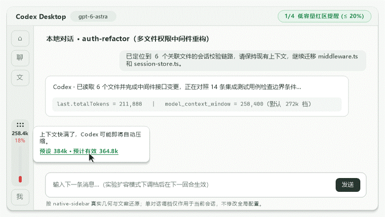
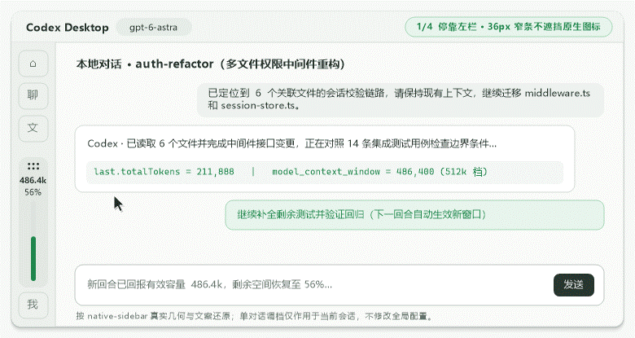
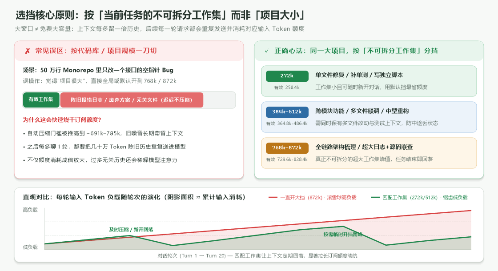
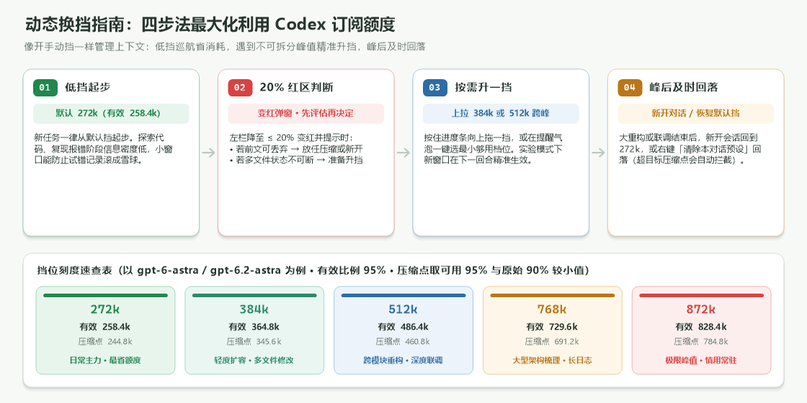

# Codex Context Manager

**简体中文** | [English](README.en.md)

> **面向 Windows x64 Codex 桌面的本地上下文窗口监控与单对话挡位管理工具（`v0.1.0`）**
>
> 把订阅额度留给仍需推理的内容。左栏显示当前对话还能装下多少上下文，帮助你决定何时继续、何时压缩，以及哪一条对话值得临时扩容。
>
> *原有 Context Lens 安装可直接覆盖升级；开始菜单、快捷方式与左栏扩展标识继续沿用 **Context Lens**。*

[下载 Windows x64 安装包](https://github.com/loyce-cheng/codex-context-manager/releases/download/v0.1.0/Codex-Context-Manager-0.1.0-windows-x64-Setup.exe) · [查看 0.1.0 发布文件与 SHA-256 校验值](https://github.com/loyce-cheng/codex-context-manager/releases/tag/v0.1.0)

---

下载链接指向已发布的 `v0.1.0`。`main` 上的后续源码修复见[审查记录](docs/REVIEW-0.1.0.md)。

## 目录

- [为什么需要管理上下文窗口](#为什么需要管理上下文窗口)
- [交互与调节效果预览](#交互与调节效果预览)
  - [拖拽调档与下一回合确认](#拖拽调档与下一回合确认)
  - [左栏停靠与悬浮形态切换](#左栏停靠与悬浮形态切换)
- [按不可拆分工作集选挡](#按不可拆分工作集选挡)
  - [什么是不可拆分工作集](#什么是不可拆分工作集)
  - [挡位与工作集对照表](#挡位与工作集对照表)
- [动态换挡指南](#动态换挡指南)
- [安装与使用](#安装与使用)
- [功能边界与兼容范围](#功能边界与兼容范围)
- [隐私与安全边界](#隐私与安全边界)
- [常见问题排查](#常见问题排查)
- [开发与构建](#开发与构建)
- [开源许可](#开源许可)

---

## 为什么需要管理上下文窗口

窗口大小是一次请求可容纳的上限。把挡位从 `272k` 调到 `512k`，不会凭空多出 `240k` 输入 token。两种选择的差别会在历史累积时显现：较大的窗口能推迟压缩，使旧日志也可能随接下来的每次请求再次作为输入；较小的窗口可能更早压缩，后续工作有时需要重新读文件。按任务选择窗口，可以减少无用输入和重复读取，让同一份订阅额度用在更多有效工作上。实际额度消耗还取决于模型、任务、推理和工具使用等因素。[OpenAI 对 Codex 订阅用量的说明](https://help.openai.com/en/articles/11369540-using-codex-with-your-chatgpt-plan)

**即使每次都命中缓存，反复携带过长的上下文也会积累用量。** 按 token 计费的 Codex credits 对缓存输入采用较低的非零费率。同一段旧日志随请求发送 20 次，就可能计入 20 次缓存输入；一次用户指令也可能产生多次模型请求。订阅内含额度的剩余百分比应以账户用量页为准。[OpenAI 的 Codex 用量说明与缓存输入费率](https://learn.chatgpt.com/docs/pricing?codex-pricing-plans=individual#token-rates)

- **故障已定位，接下来只需改两行代码。** 假设旧日志占 `60k` token，复现步骤和错误摘要只占 `5k`。如果后续 20 次模型请求都保留这段材料，旧日志比摘要多带 `(60k − 5k) × 20 = 1.1M` 个输入 token。即使两种方案的这部分输入都完全命中缓存，按每百万缓存输入 `10 credits` 的示例费率，仅这项差额就有 `11 credits`。例子未计生成摘要的开销；实际费率取决于模型和计费方案。
- **正在迁移协议，下一步仍要逐项核对旧字段。** 如果原始字段表、调用方和失败断言都还要用，过早压缩可能导致多次重读。此时可只给迁移对话临时升到 `512k`，让另一条写发布说明的对话继续用模型默认档。等迁移验收完成，再用简短的决策记录开始后续工作。

左栏的 **20%** 表示当前对话还剩约五分之一的上下文空间。账户剩余额度请查看 Codex 用量页。普通监控可辅助上述判断，已验收的实验组合还可实际调整单条对话的窗口。

---

## 交互与调节效果预览

### 拖拽调档与下一回合确认

剩余容量降至 **20% 或以下**时，进度条变红并显示 5 秒提醒。按住进度条拖动，或用方向键选档、回车确认，可以预览预计有效容量和剩余比例。松手后，普通模式会保存本对话和模型的预设。实验模式显示 **「已提交」** 后，发送下一条消息；看到 **「已生效」** 和实测容量才表示后台已采用该档。20% 是插件的提醒线，实际压缩由 Codex 后台决定。



> 演示按 `native-sidebar` 真实几何、文案与状态流转还原：`预设已保存` → 实验桥接写入后 `已提交` → 回落至实测读数 → 下一回合校验原生用量后弹出 `已生效 · 486.4k`。

### 左栏停靠与悬浮形态切换

默认以 **36px 窄条** 停靠在 Codex 左侧导航栏（不遮挡原生按钮，空间不足时自动退让）。握住顶部的 6 点握柄向右拖出即可转为**横向悬浮条**；右击菜单可切换**竖向悬浮**、**固定回左侧栏**、查看容量预设或清除本对话预设。位置与方向偏好按窗口独立记忆：



---

## 按不可拆分工作集选挡



使用本工具最容易踩的坑，是看到代码库很大就把所有对话都调到高挡位。**不要按「项目大小」选挡位，要按「当前任务的不可拆分工作集（Working Set）」选挡位。**

### 什么是不可拆分工作集

它指**模型在一次连贯推理中必须同时握在手里的最小信息集合**——包括需要联动修改的源文件、接口契约、关键报错/测试输出，以及一旦被中途压缩就会导致失忆或改漏的设计约束。

- **大项目里的小任务 → 用小挡**：在 50 万行 Monorepo 里修一个接口的空指针 Bug，真正需要同时看到的往往只有 2~3 个文件和一段测试输出。可以先用当前模型的默认档，完成后再开新对话。
- **小项目里的硬骨头 → 可开中/高挡**：即使仓库只有 2 万行，但如果你正在做跨协议/状态机/并发锁的整体迁移，必须同时对照 10 多个文件与长日志，此时中途压缩代价极高，临时拉到 **`384k` 或 `512k`** 有助于减少重复读取和返工。

### 挡位与工作集对照表

完整启动器使用本机模型目录，单独导入的 ZIP 使用内置快照。下表使用快照中的 `gpt-6-astra` / `gpt-6.2-astra` 举例（默认 `272k`、上限 `872k`、有效比例 `95%`）。压缩点是实验挡位的估算，默认档的实际压缩策略由后台决定。

| 配置挡位 | 有效上下文容量 (`95%`) | 预计自动压缩点 | 适用工作集特征 | 典型任务示例 |
| :--- | :--- | :--- | :--- | :--- |
| **`272k`（默认）** | **`258.4k`** | `244.8k` | 小工作集、边界清晰、可随时新开 | 单文件修 Bug、补单测、解释代码、写独立脚本 |
| **`384k`** | **`364.8k`** | `345.6k` | 中小工作集、轻度跨文件 | 3~6 个关联文件改动、接口字段联调、中等 PR Review |
| **`512k`** | **`486.4k`** | `460.8k` | 中型不可拆分工作集 | 跨模块功能实现、多文件重构、完整测试链路排查 |
| **`768k`** | **`729.6k`** | `691.2k` | 大型不可拆分工作集 | 核心子系统重构、长堆栈/抓包日志与多处源码联合定位 |
| **`872k`（上限）** | **`828.4k`** | `784.8k` | 极限单次峰值（**慎用常驻**） | 极少数无法切分的全局架构梳理，完成后立即新开或回落 |

> **注**：不同模型的默认窗口不同（例如 `gpt-6.2-sol` / `gpt-6.1-sol` / `gpt-6.1-terra` 默认 `500k`，有效 `475k`，可选档位为 `500k / 512k / 768k / 872k`）。右击窄条选择 **「查看容量预设」** 可随时查看当前模型的目录默认值及所选预设的估算值。

---

## 动态换挡指南



把上下文挡位当成汽车的**手动挡**来用，而不是设完就忘的全局开关：

1. **从当前模型的默认档起步**
   开启新任务时，**不要预先升挡**。需求澄清、搜代码、复现报错阶段信息噪声最多，保持默认小窗口能避免试错记录把上下文撑胖。
2. **遇到 `≤ 20%` 红区提醒，先做「分叉判断」**
   当左栏剩余容量跌至 **20% 及以下**（进度条变红并弹出 5 秒提醒）时，先判断前面历史是否仍不可替代：
   - **前文多为排错废话或子任务已收尾** → **不要升挡！** 放任自然压缩，或总结结论后**新开一条对话**使用当前模型的默认档。
   - **正处在多文件修改中途，此刻压缩会丢失关键状态** → 进入下一步精准升挡。
3. **按需升一挡跨过峰值（逐级上调，不一步拉满）**
   - 如果气泡提供**一键推荐**，可直接点击（工具会自动算出能让剩余空间回到 20% 以上的**最小够用档位**），或按住进度条向上拖到 **`384k` / `512k`**。
   - 实验扩容模式下，看到 **`已提交`** 提示后发送下一条消息，新窗口在下一回合生效，左栏收到实测读数后弹出 **`已生效 · 486.4k`**。正在生成的回合会保留原窗口直到结束。
4. **峰值过后及时回落，并善用多对话隔离**
   - **单对话独立隔离**：你可以同时让「对话 A（大重构）」跑在 `512k`，同时让「对话 B（写小工具/查文档）」保持在 `272k`，互不干扰，也不会污染全局配置。
   - **峰后回落**：大型改动收尾后**新开对话**使用所选模型的默认容量；也可在压缩后右击窄条点击 **「清除本对话预设」**（或拖回默认挡）。若当前已用 Token 已达到目标低挡的预计压缩阈值，拖动选档时会提示选择更大的档位。清除预设后，请在实验模式的后续回合核对实测容量。

---

## 安装与使用

### 方式一：Windows x64 一键安装包（推荐）

1. 先安装 Windows 版 Codex，保存工作并完全退出 Codex 与 Codex Script Loader。
2. 从 Release 下载并运行 `Codex-Context-Manager-0.1.0-windows-x64-Setup.exe`（未签名程序，下载后可用 `Get-FileHash -Algorithm SHA256` 对照 Release 中的 `SHA256SUMS.txt` 核验）。
   - 默认选项安装 **「仅监控」**；当本机 Codex 与 Loader 版本命中已验收实验组合时，可勾选 **「监控和实验扩容」**。
   - 安装包内置 Node.js 运行时与便携 Loader；已有兼容共享 Loader 的电脑会优先复用现有安装，保留其他扩展的配置。
3. 从开始菜单 **Context Lens** 文件夹启动：
   - **Codex + Context Lens**：日常左栏监控（支持按对话保存预设）。
   - **Codex + Context Lens（实验扩容）**：启用单对话真实调档（仅勾选实验组件后提供；首次从普通模式切换时按提示保存并退出普通 Codex，启动器会在 15 分钟内自动接管启动）。
   - **查看状态**：只读排查当前左栏读数、布局空间与本机 Codex / Loader 兼容状态。
   - **恢复 Loader**：遇到更新后旧 Loader 留在后台无响应时，打开原生诊断窗口退出（或在确认所有 Codex 窗口已退出后安全结束残留实例）。

### 方式二：仅手动导入左栏扩展 ZIP

如果你已独立安装 [Codex Script Loader](https://github.com/JHees/codex-script-loader) 且只需要左栏监控，可直接下载 `context-lens-sidebar-0.1.0.zip`，在 Codex 设置的 Script Loader 页面导入并启用（无需 Node、Python 或管理员权限）。

> **提示**：单独导入扩展 ZIP 仅提供左栏监控与档位预设保存；单对话真实调档依赖完整安装包中的已验收实验后台与桥接组件。

### 升级与卸载

- **覆盖升级**：退出 Codex 和 Loader 后直接运行新版安装包即可覆盖升级，原有 Loader 配置、其他插件、对话记录与容量偏好均会保留。
- **卸载**：前往 **Windows 设置 → 应用 → 已安装的应用 → Codex Context Manager** 卸载。

---

## 功能边界与兼容范围

| 能力 | 普通监控模式 | 实验扩容模式 |
| :--- | :--- | :--- |
| 左栏实时显示有效容量与剩余百分比 | 已支持（剩余百分比 = `100 × (1 − last.totalTokens / modelContextWindow)`，限制在 0–100） | 已支持 |
| 低容量预警（`≤ 20%` 变红提醒，恢复 `> 25%` 重置） | 已支持 | 已支持 |
| 停靠左栏 / 拖出横向或竖向悬浮 / 记忆窗口偏好 | 已支持 | 已支持 |
| 拖拽或键盘预览档位并按 `(对话, 模型)` 保存预设 | 已支持 | 已支持 |
| 单对话真实调整后台窗口（下一回合生效并实测回执） | 仅保存预设，不改动官方后台 | **已支持（按已验收组合启用）** |
| Codex 更新后自动页面资源静态检查 | 启动时自动核对 Rspack 页面资源 | 遇到未验收版本自动安全退回普通监控，不丢失预设 |
| 远程 / 云端会话，或未选中本地主对话 | 暂不支持（自动清空读数，不沿用旧值） | 暂不支持 |

- **已验收实验扩容组合**：Windows x64 Codex `26.1117.3838.0` 或 `26.1117.4957.0` + Codex Script Loader `0.6.2`（配套独立实验后台 `0.171.0-alpha.13`）。
- **左栏内置页面适配**：已内置 `26.1120.5083.0` 及此前多版 Rspack/ESM 页面资料；更高版本由本地启动器在启动前通过只读 AST 检查尝试适配（仅当会话身份、用量与布局全部核验通过时才启用）。
- **其他模式**：仓库同时包含只读 MCP 面板与独立本地浏览器/文件模式（`src/server/mcp.mjs`、`src/server/file.mjs`、`src/server/http.mjs`），供不使用 Script Loader 的场景或开发调试使用。

---

## 隐私与安全边界

- **本地计算**：左栏使用当前窗口的原生用量，不读取 `auth.json`，不向项目方上报用量或聊天内容。启动器和 Loader 通过本机接口通信。
- **最小化本地存储**：显示偏好保存在专属键 `context-lens.sidebar.ui.v1`；容量预设仅按 `context-lens.target.v1.local.<threadId>.<model>` 保存一个档位数值；实验模式仅向 `%CODEX_HOME%\context-lens-desktop-tiers-v1\<threadId>.json` 写入 `{ threadId, expectedModel, selection }`。
- **绝不静默修改全局配置**：不会改写 Codex 全局上下文设置、权限策略或 Loader 启用开关；禁用或移除扩展会完整清理 DOM、监听器与计时器，不修改 Codex 安装文件。
- **关于 Script Loader 权限**：Script Loader 通过本机回环调试接口向 Codex renderer 注入脚本，不具备官方插件隔离沙箱边界，请仅安装可信来源的脚本。实验后台、实验 Loader 与配套运行时均在构建与启动阶段做 SHA-256 完整性核验。

---

## 常见问题排查

- **左栏没出现？** 打开开始菜单 **Context Lens → 查看状态**，会直接提示是「等待打开本地对话」「左侧导航栏已折叠」「窗口过矮空间不足」还是「Loader 尚未连接」。
- **Codex 升级后打不开或提示连不上？** 先保存工作并完全退出 Codex；若旧 Loader 留在后台，点击 **恢复 Loader** 退出后再重新打开快捷方式。
- **左栏显示两个「—」？** 打开已有用量的本地对话，或在新对话中完成一个回合。若「查看状态」提示页面用量接口未适配，重新发送消息无法修复接口，请查看项目的新版本。
- **选了 `512k` 却仍然显示 `258.4k`？** 普通模式只保存预设。实验模式中请在同一对话、同一模型看到「已提交」后发送消息。模型有效比例为 95% 时，`512k` 对应 `486.4k`；以随后收到的原生读数为准。
- **更新之后只剩监控？** 用原快捷方式启动，启动器会核对新页面资源。实验后台按版本组合单独验收；若「查看状态」提示尚待验收，可继续使用已通过检查的监控功能。无需手改版本号。
- **找不到「恢复 Loader」？** 发布页也提供独立的 `Codex-Context-Manager-0.1.0-Recovery.exe`。保存工作、退出 Codex 后再运行。
- **怀疑防火墙拦截？** 先用「查看状态」排查。源码工作区准备好随包运行时后可执行 `Diagnose-Sidebar.cmd`。网络诊断与可撤销的回环规则脚本供源码维护者按需使用，安装包用户无需为日常启动调整防火墙。

---

## 开发与构建

项目核心无生产 npm 依赖（运行测试与构建需 Node.js `>= 22.0.0`，Windows 打包运行时锁定 Node `v24.19.0`；打包脚本需 Python 3.11+，安装器构建需 Inno Setup 与 .NET Framework `csc.exe`）：

```powershell
# 语法与内联打包检查
npm run check

# 运行全部单元测试
npm test

# 只读检查本机桌面、Loader 与页面兼容状态
npm run check:desktop-compat

# 用已安装的官方后台运行隔离恢复和压缩测试
npm run verify:stock-resume

# 构建左栏扩展目录与独立导入 ZIP
npm run build:sidebar
python scripts/package-sidebar.py

# 编译无控制台 Windows 启动器与恢复工具
pwsh -File scripts/build-launcher.ps1
```

在当前开发源码中，实验快捷方式遇到未验收的更新时，会先打开普通监控，再用本机模拟对话检查官方后台。测试覆盖同一对话调档、另一个对话保持原容量、冷启动恢复以及自动压缩。结果按桌面版本、官方后台文件 SHA-256 和测试版本缓存；换版本或后台文件变化后会重新检查。未能确认时隔天可自动重试，手动立即重跑可用 `npm run verify:stock-resume -- --force`。结果保存在 `%LOCALAPPDATA%\ContextLens\stock-resume-check.json`。此检查使用临时资料目录，模拟回合在本机完成。通过后仅说明官方后台支持这些操作，真实桌面的左栏接入仍在开发中。`v0.1.0` 安装包不含此检查。

更多文档：
- 本次源码审查与修复范围：[0.1.0 审查记录](docs/REVIEW-0.1.0.md)
- 发布说明：[docs/RELEASE-0.1.0.md](docs/RELEASE-0.1.0.md)
- 左栏扩展细节：[native-sidebar/README.md](native-sidebar/README.md)
- 单对话扩容后台原型与复现：[experiments/desktop-context-window/README.md](experiments/desktop-context-window/README.md)
- 第三方运行时与许可说明：[third_party/README.md](third_party/README.md)

---

## 开源许可

MIT License. 详见 [LICENSE](LICENSE) 与 [third_party/README.md](third_party/README.md)。
